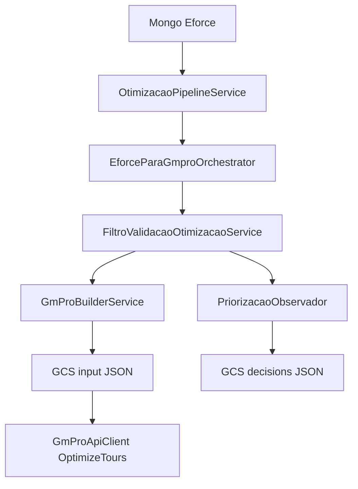

# Plano de Implementação: Fundação da priorização adaptativa

## Visão Geral

O [MsGodOtimizador](https://devops.energisa.com.br/Energisa/OperacaoDespacho/_git/MsGodOtimizador) já transforma atributos da OS em `PesoFinal` e envia esse número à Google Route Optimization API como `Shipment.PenaltyCost`. Este plano acrescenta uma camada observável ao lado desse fluxo: decisão reproduzível, constraints com motivo, baseline manual encapsulado e um baseline determinístico que só é calculado e registrado. A ordem das visitas continua saindo de `OptimizeToursResponse.Routes`.

O código de trabalho é a cópia do MsGodOtimizador (.NET 8) neste repositório, obtida de `https://devops.energisa.com.br/Energisa/OperacaoDespacho/_git/MsGodOtimizador`.

## Análise do Estado Atual

A prioridade não ordena a rota neste serviço. O solver é a API Google.

- Os pesos vêm do Mongo `Eforce:ValoresPesoOtimizacao`, entram em `ConversaoConstantes.CarregarDeParametro` e não têm default compilado. `100000` aparece no fixture de teste (`ConversaoConstantesTestSetup`), não como constante de produção.
- `EforceParaGmproOrchestrator.CalcularPesos` (por volta da linha 512) faz min-max do lote e soma onze termos com `PotenciaPesos ^ Importancia` em `OsProcessada.PesoFinal`.
- `GmProBuilderService` (por volta da linha 186) publica `PenaltyCost = floor(PesoFinal)`, com piso 1. Na API Google, penalty maior significa custo maior de deixar a OS de fora.
- `VerificarCompatibilidade` (por volta da linha 668) restringe perfil, região, zona U/R e serviço de uma pessoa. O par inviável some de `AllowedVehicleIndices`. Não há reason code.
- `FiltroValidacaoOtimizacaoService.AplicarFiltros` remove coordenada inválida e OS que ficou sem equipe. `ValidadorRequestGmPro.Validar` barra request crítica antes do upload.
- `OtimizacaoPipelineService.ConstruirRequestAsync` (a partir da linha 119) é o único lugar da otimização completa: conversão, filtro, `Build`, validação, upload GCS em `input/...` e `IOtimizadorRotasRepository.CriaRequestOtimizadorAsync`. A reotimização repete o cálculo de peso em `ExecutarReotimizacaoAsync`.
- `GmProApiClient` chama `OptimizeTours` / `OptimizeToursUri`. Não há matriz de distância, retry nem fallback de solver. Timeout da request Google: 15 minutos no request; timeout do client: 60 minutos.
- Horizonte do solver: turno do dia da execução. Seleção prévia no Mongo: OS até 90 dias, vencimento comercial em até 5 dias. Cron de 30 minutos, e o worker só segue se a hora local estiver na janela de `Eforce:HorarioOtimizacaoAgendada`.
- Não há SLA nomeado, feature flag de priorização, snapshot de candidatos nem registro de decisão. O que se guarda é o protobuf de request/response no GCS e o resultado no repositório LibGod, fora desta solution.
- Testes: xUnit em `Energisa.Eforce.Otimizador.Tests`, nome `{Metodo}_{Cenario}_{Resultado}`.

`PenaltyCost` e o `ScoreResult` das guidelines usam sentidos opostos. O valor publicado na Google continua sendo custo de skip (maior = atender antes). O score determinístico novo usa custo a minimizar e não é copiado para `PenaltyCost`.

O observador lê o mesmo lote já filtrado. Ele não devolve score para o builder.

## Estado Final Desejado

Com `Priorizacao:Mode` em `Off` (default), o `OptimizeToursRequest` e o upload `input/` permanecem iguais aos de hoje, e nenhum objeto `decisions/` é criado.

Com `LogOnly`, cada construção de request grava um envelope versionado com snapshot, constraints, score `manual-v1` decomposto, fingerprint e a referência do input GCS. Falha desse upload não interrompe a otimização.

Com `Shadow`, o mesmo envelope inclui também `deterministic-v1`. `PenaltyCost` continua o de `manual-v1`.

Replay de fixture: o mesmo lote e o mesmo dicionário de `ConversaoConstantes` reproduzem `PesoFinal`, `PenaltyCost` e o conjunto de pares permitidos.

## O Que NÃO Estamos Fazendo

- Trocar `PenaltyCost`, time windows, `CostPerKilometer`, `FixedCost` ou o search mode da Google.
- Introduzir solver local, learning-to-rank, modelo preditivo, bandit, reinforcement learning, exploração ou modo `Assist` / `Active`.
- Reclassificar risco à vida como hard constraint. No código ele é peso, janela e multa. A reclassificação fica registrada como decisão de governança pendente e bloqueia somente autonomia, que este plano não liga.
- Passar criticidade para o provedor de rota. A Google segue recebendo somente o request atual.
- Alterar a LibGod ou criar coleção Mongo nova. O repositório de rotas está fora desta solution.
- Gravar desfecho de campo (chegada, conclusão, primeira resolução). Este serviço não vê esses eventos.
- Aplicar `PesoBase`, `PesoPrazoQuaseExcedendo`, `CustoFixoVeiculo` e `DistribuicaoAutomatica`. Estão no parâmetro e hoje não entram em `CalcularPesos`.
- Normalizar de novo o `manual-v1`. O min-max do lote faz o peso de uma OS depender das outras; isso é propriedade da política atual e o replay precisa preservá-la.

## Abordagem de Implementação

Nova pasta `Energisa.Eforce.Otimizador/Priorizacao/`, com namespace igual ao caminho, conforme [GUIDELINES.md](Energisa.Eforce.Otimizador/GUIDELINES.md). Regra de negócio fica na class library. Api e Cronjob só registram `IOptions<PriorizacaoSettings>` e o serviço scoped.

O `OtimizacaoPipelineService`, que já é scoped, chama o observador depois de `AplicarFiltros` e de `Build`, na otimização completa e na reotimização. O orquestrador singleton não recebe dependência de storage.

Flags em `appsettings` dos dois hosts, default seguro. `KillSwitch: true` força `Off`. Valor fora de `Off`, `LogOnly` e `Shadow` é tratado como `Off` e gera reason code `UNSUPPORTED_MODE_TREATED_AS_OFF`.

Segurança, aplicada nas fases de log:

- Allowlist no JSON de decisão: ids de OS e equipe, região, categoria, versões, scores, reason codes e hashes. Sem nome de cliente, sem latitude/longitude e sem body do request Google. [Norma 4.4.1.c, 4.4.1.f, 4.4.1.o] [Norma 4.4.5.f, 4.4.5.h]
- O objeto usa o bucket e o cliente GCS já existentes, no prefixo `decisions/`. Sem bucket novo e sem ACL pública. [Norma 4.4.2.6.e]
- Modo e kill switch são configuração de deploy, validados no servidor, default `Off`. Mudança de modo entra no log estruturado com o valor efetivo. [Norma 4.4.1.q] [Norma 4.4.13.1.a]
- Nenhuma credencial nova e nenhum pacote NuGet novo. Fingerprint com SHA-256 do snapshot canônico, não de senha. [Norma 4.4.2.5.g]

<!-- FASE: 1 -->
## Fase 1: Contratos e baseline manual

### Visão Geral

Criar os contratos v1 e um scorer puro que decompõe a fórmula já existente, sem ser chamado pelo pipeline.

### Mudanças Necessárias

#### 1. Settings

**Arquivo**: `Energisa.Eforce.Otimizador/Configuration/PriorizacaoSettings.cs`

**Mudanças**: seção `Priorizacao`, com `Mode` default `Off`, `KillSwitch` default `false` e `DecisionPrefix` default `decisions/`. XML doc em cada propriedade. Registrar `IOptions<PriorizacaoSettings>` em `Energisa.Eforce.Otimizador.Api/Program.cs` e `Energisa.Eforce.Otimizador.Cronjob/Program.cs`. Incluir a seção nos `appsettings.json` dos dois hosts com `Mode` = `Off`.

#### 2. Contratos

**Arquivo**: `Energisa.Eforce.Otimizador/Priorizacao/Contratos/`

**Mudanças**: records `DecisionSnapshot`, `ConstraintEvaluation`, `CandidatePair`, `ScoreComponent`, `ScoreResult`, `PlanDecision`, `DecisionEnvelope`. `schema_version` = `1.0.0`. `ScoreResult` carrega `Direction` por componente. Para `manual-v1`, a direção de `peso_final` é `HigherSkipCostIsMoreUrgent`.

O snapshot guarda ids, timestamps em UTC, flags (`RiscoVida`, `ClienteEssencial`, tipo, regulada, reincidência), tempos (`TempoAberta`, `TempoVencida`, vencimento) e a cópia de `ConversaoConstantes.ToValoresDictionary()` já carregada. Não guarda coordenada.

#### 3. Scorer manual

**Arquivo**: `Energisa.Eforce.Otimizador/Priorizacao/ManualBaselineScorer.cs`

**Mudanças**: extrair a matemática de `CalcularPesos` para um método puro que recebe o lote e o dicionário de parâmetros e devolve, por OS, os onze termos já somados e o `PesoFinal`. `EforceParaGmproOrchestrator.CalcularPesos` passa a chamar esse método e a atribuir `PesoFinal` como hoje, inclusive o valor inicial 10 do modelo. Os testes atuais do orquestrador são a rede de caracterização.

`PublishedPenaltyCost` = `floor(PesoFinal)` com piso 1, a mesma expressão de `GmProBuilderService`.

### Critérios de Sucesso

#### Verificação Automatizada

- [ ] `dotnet test Energisa.Eforce.Otimizador.Tests/Energisa.Eforce.Otimizador.Tests.csproj` passa, incluindo os testes já existentes do orquestrador e do builder.
- [ ] Novo teste: lote fixo do `TestDataFactory` produz os mesmos `PesoFinal` e `PenaltyCost` antes e depois da extração.
- [ ] Novo teste: reordenar a entrada não altera o resultado; lote com máximo igual ao mínimo zera o fator, como `ConversaoHelper.MinMaxScale`.
- [ ] Novo teste: settings ausente equivale a `Off`.
- [ ] `dotnet build Energisa.Eforce.Otimizador.sln` passa.

#### ⛔ Pausa Obrigatória

- [ ] Aguardar confirmação explícita do usuário ou orquestrador antes de iniciar a próxima fase.

---

<!-- FASE: 2 -->
## Fase 2: Motor de constraints

### Visão Geral

Uma única implementação passa a decidir o par OS–equipe e a devolver reason code. O conjunto permitido permanece o de `VerificarCompatibilidade`.

### Mudanças Necessárias

#### 1. Motor

**Arquivo**: `Energisa.Eforce.Otimizador/Priorizacao/ConstraintEngine.cs`

**Mudanças**: API pura `EvaluatePair(os, equipe, snapshot) -> ConstraintEvaluation`. Regras v1, todas `BLOCK`, owner `operations`, `constraint_set_version` = `2026.11.0`:

- `TEAM_REQUIRED_PROFILE` / `MISSING_REQUIRED_PROFILE`
- `TEAM_REGION` / `REGION_MISMATCH`
- `TEAM_ZONE` / `ZONE_MISMATCH`
- `TEAM_CREW_SIZE` / `SINGLE_PERSON_RESTRICTED_SERVICE`
- `OS_COORDINATES` / `INVALID_COORDINATES`
- `OS_TEAM_ASSIGNMENT` / `NO_COMPATIBLE_TEAM`

Fail closed: dado obrigatório ausente recusa o par e preenche o reason code. Não há caminho que marque `allowed` quando a regra não pôde ser lida.

`VerificarCompatibilidade` e o filtro de coordenada passam a usar o motor. `AtribuirEquipes` continua gravando os mesmos índices.

#### 2. Validação de plano

**Arquivo**: `Energisa.Eforce.Otimizador/Priorizacao/PlanValidator.cs`

**Mudanças**: dado o request já construído, confirma que todo `AllowedVehicleIndices` aponta para par `allowed` e que shipment sem índice continua fora do request. Reusa o resultado de `ValidadorRequestGmPro` como violação de plano, sem alterar o critério de interrupção já existente (inconsistência crítica ainda retorna `ErroInterrupcao`).

### Critérios de Sucesso

#### Verificação Automatizada

- [ ] `dotnet test` passa, inclusive `EforceParaGmproOrchestratorTests`, `EforceParaGmproOrchestratorEdgeCaseTests` e `FiltroValidacaoOtimizacaoServiceTests`.
- [ ] Cada regra tem teste positivo, negativo e de fronteira (perfil vazio, região `empresa_codigo`, atuação `U/R`, corte no poste com `NPessoas == 1`, coordenada nula).
- [ ] Teste de propriedade: nenhum par recusado pelo motor aparece em `IndicesEquipesPermitidas`.
- [ ] O motor não referencia `GmProApiClient`, scorer nem storage.

#### ⛔ Pausa Obrigatória

- [ ] Aguardar confirmação explícita do usuário ou orquestrador antes de iniciar a próxima fase.

---

<!-- FASE: 3 -->
## Fase 3: LogOnly na construção da request

### Visão Geral

Gravar o envelope da decisão no GCS quando o modo for `LogOnly` ou `Shadow`. `Off` não chama o storage.

### Mudanças Necessárias

#### 1. Observador

**Arquivo**: `Energisa.Eforce.Otimizador/Priorizacao/PriorizacaoObservador.cs`

**Mudanças**: serviço scoped. Monta `decision_id`, snapshot, avaliações, candidatos (par permitido e par recusado), `ScoreResult` de `manual-v1`, `policy_version` = `manual-v1`, fingerprint SHA-256 canônico e `PlanDecision.Mode`. Faz upload com `GoogleCloudStorageService.UploadJsonComReferenciaAsync` em `{DecisionPrefix}{prefixo-ambiente}{guid}.json`, no mesmo bucket de `GcsSettings`.

O prefixo de ambiente reutiliza a regra já usada em `OtimizacaoPipelineService.ObterPrefixoArquivo` (`dev_`, `hml_`, `prd_`, `esp_`).

Falha de upload ou serialização é capturada, logada com `decision_id` e reason code `AUDIT_LOG_FAILED`, e a construção da request continua. O log estruturado lista só `decision_id`, `label`, modo, contagens e nome do objeto.

#### 2. Gancho no pipeline

**Arquivo**: `Energisa.Eforce.Otimizador/Services/OtimizacaoPipelineService.cs`

**Mudanças**: depois de `Build` e da validação sem crítica, em `ConstruirRequestAsync` e no caminho equivalente de `ExecutarReotimizacaoAsync`. O observador não altera `request` nem `objectName` do input. `KillSwitch` ou modo `Off` pula o bloco inteiro.

### Critérios de Sucesso

#### Verificação Automatizada

- [ ] `dotnet test` passa.
- [ ] Com modo `Off`, o mock de storage recebe zero uploads de decisão e o JSON do `OptimizeToursRequest` permanece igual.
- [ ] Com `LogOnly`, o mock recebe um objeto cujo `PenaltyCost` registrado coincide com o shipment e cujo JSON não contém `Latitude`, `Longitude` nem nome de cliente.
- [ ] Exceção do storage não altera o `ResultadoConstrucaoRequest` de sucesso.
- [ ] `KillSwitch: true` com `Mode: LogOnly` não faz upload.

#### Verificação Manual

- [ ] Num ambiente de Desenvolvimento, uma otimização com `LogOnly` gera o objeto `decisions/` e o `input/` da mesma execução; o `PenaltyCost` dos dois artefatos coincide para uma OS amostrada.

#### ⛔ Pausa Obrigatória

- [ ] Aguardar confirmação explícita do usuário ou orquestrador antes de iniciar a próxima fase.

---

<!-- FASE: 4 -->
## Fase 4: Baseline determinístico em shadow e replay

### Visão Geral

Calcular `deterministic-v1` somente para comparação no envelope. O valor não entra no request Google.

### Mudanças Necessárias

#### 1. Scorer determinístico

**Arquivo**: `Energisa.Eforce.Otimizador/Priorizacao/DeterministicBaselineScorer.cs`

**Mudanças**: função pura, direção `Minimize`, versão `deterministic-v1`. Denominadores fixos no código, versionados em `objective-1.0.0`, sem estatística do lote e sem ler `PesoRiscoVida` nem os outros pesos manuais.

Componentes, cada um em `[0, 1]` após clip:

- `risk_cost`: 1 quando `RiscoVida == "S"`, senão 0. Sinal de preferência, não constraint.
- `critical_service_cost`: 1 quando cliente essencial e não há risco à vida, senão 0.
- `sla_cost`: horas já vencidas / 24 h, clipado; se ainda não venceu, `1 - (horas restantes / 24 h)` com piso 0.
- `waiting_cost`: `TempoAberta` / 168 h, clipado.
- `travel_cost`: haversine até a garagem compatível mais próxima / 50 km, clipado, qualidade `ApproximateHaversine`. Sem chamada extra à Google.
- `quality_cost`: 1 quando `Reicidencia == "S"`, senão 0.
- `overtime_cost` e `instability_cost`: 0, com `missing_behavior: not_available_before_route`. Na reotimização, `instability_cost` = 1 para OS em deslocamento ou despachada pendente.

O total de comparação, só no envelope, é a soma lexicográfica documentada: camada de risco, depois SLA/espera, depois viagem. Coeficientes fixos 1 dentro da camada. Nenhum termo usa valor “infinito”.

`Shadow` grava os dois `ScoreResult`. `LogOnly` grava apenas `manual-v1`.

#### 2. Replay

**Arquivo**: `Energisa.Eforce.Otimizador.Tests/Priorizacao/DecisionReplayTests.cs`

**Mudanças**: fixture anonimizada com o dicionário de `ConversaoConstantesTestSetup` e três OS (risco à vida, regulada a vencer, lote). O replay recalcula pares factíveis, componentes e `PublishedPenaltyCost`. Segunda execução com o mesmo input produz o mesmo fingerprint.

### Critérios de Sucesso

#### Verificação Automatizada

- [ ] `dotnet test` passa.
- [ ] Teste: `deterministic-v1` não lê as chaves `Peso*` para montar o total.
- [ ] Teste: dobrar o tamanho do lote com OS idênticas não muda o componente de uma OS já presente. O `manual-v1` pode mudar, e o teste registra isso.
- [ ] Teste: modo `Shadow` mantém o `PenaltyCost` do builder igual ao `manual-v1`.
- [ ] Teste: score determinístico é finito para coordenada ausente, categoria desconhecida e vencimento nulo.

#### ⛔ Pausa Obrigatória

- [ ] Aguardar confirmação explícita do usuário ou orquestrador antes de iniciar a próxima fase.

---

<!-- FASE: 5 -->
## Fase 5: Atualização da documentação

### Visão Geral

Documentar o que passou a existir e o que continua adiado. Este repositório não tem `docs/RAIO_X_PROJETO.md` nem manual de tools MCP; esses arquivos não entram no escopo.

### Mudanças Necessárias

- `README.md`: uma linha no pipeline dizendo que `PriorizacaoObservador` registra a decisão e não altera o request. Default `Off`.
- `GUIDELINES.md`: pasta `Priorizacao/` e a regra de que hard constraint não volta a ser peso.
- `docs/priorizacao-adaptativa.md`: modos, versões (`manual-v1`, `deterministic-v1`, `objective-1.0.0`, `2026.11.0`), allowlist do envelope, e a lista do que fica para um plano posterior (modelo em shadow, assistência ao operador, canário, outcome joiner, promoção que altere `PenaltyCost`).
- Nota de governança: risco à vida segue como preferência extrema da política atual até Segurança/Operações classificarem a regra.

### Critérios de Sucesso

#### Verificação Manual

- [ ] Os documentos descrevem `Off` como default e a política Google como a que é publicada.
- [ ] Nenhum documento deste plano afirma que há modelo em produção, bandit ou RL.
- [ ] As versões citadas batem com as constantes do código.

#### ⛔ Pausa Obrigatória

- [ ] Aguardar confirmação explícita do usuário ou orquestrador antes de considerar o plano encerrado.

---

## Estratégia de Testes

### Testes Unitários

- Extração de `CalcularPesos` contra o comportamento atual.
- Cada constraint, com fronteira.
- Allowlist do JSON e falha de storage.
- Invariância do determinístico ao tamanho do lote e finitude com dado ausente.

### Testes de Integração

- Pipeline com storage mockado nos três modos, otimização completa e reotimização.
- Replay da fixture.

Não há teste que chame a API Google.

## Considerações de Performance

`Off` não serializa envelope nem chama o GCS. `LogOnly` e `Shadow` fazem um upload extra por construção de request, depois do request principal já validado. O haversine do determinístico percorre pares já classificados pelo motor, no mesmo lote que `AtribuirEquipes` já percorre.

## Referências

- Especificação: `plano-priorizacao-adaptativa.md` e `guidelines-desenvolvimento-priorizacao.md` no store do agente.
- Fórmula atual: `Energisa.Eforce.Otimizador/Services/EforceParaGmproOrchestrator.cs` (`CalcularPesos`, `VerificarCompatibilidade`).
- Publicação do peso: `Energisa.Eforce.Otimizador/Services/GmProBuilderService.cs`.
- Gancho: `Energisa.Eforce.Otimizador/Services/OtimizacaoPipelineService.cs` (`ConstruirRequestAsync`, `ExecutarReotimizacaoAsync`).
- Padrão de código: `GUIDELINES.md` do MsGodOtimizador.
